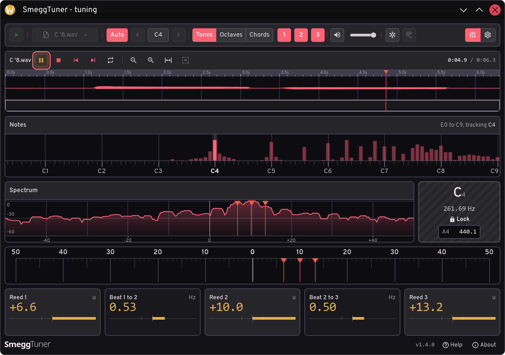
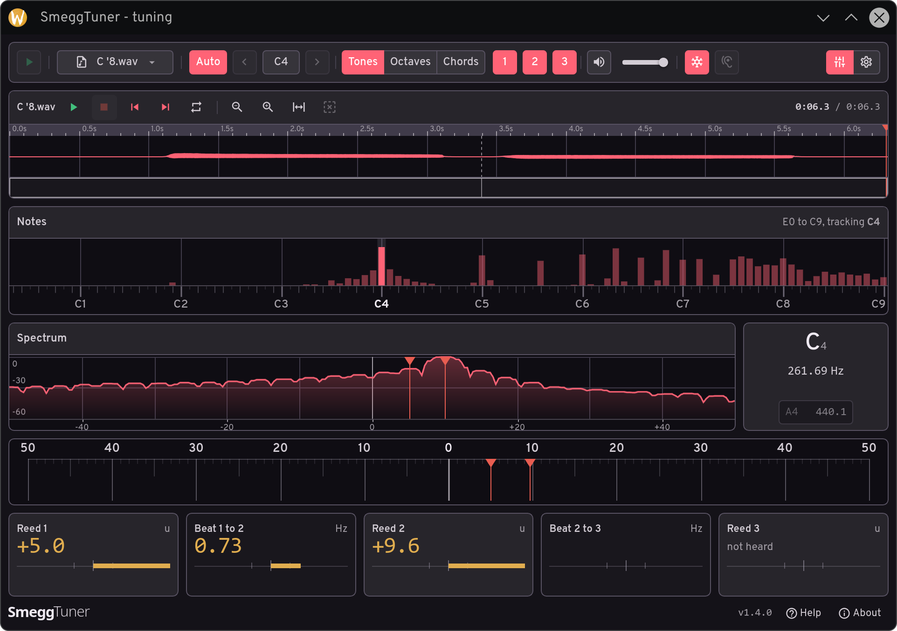
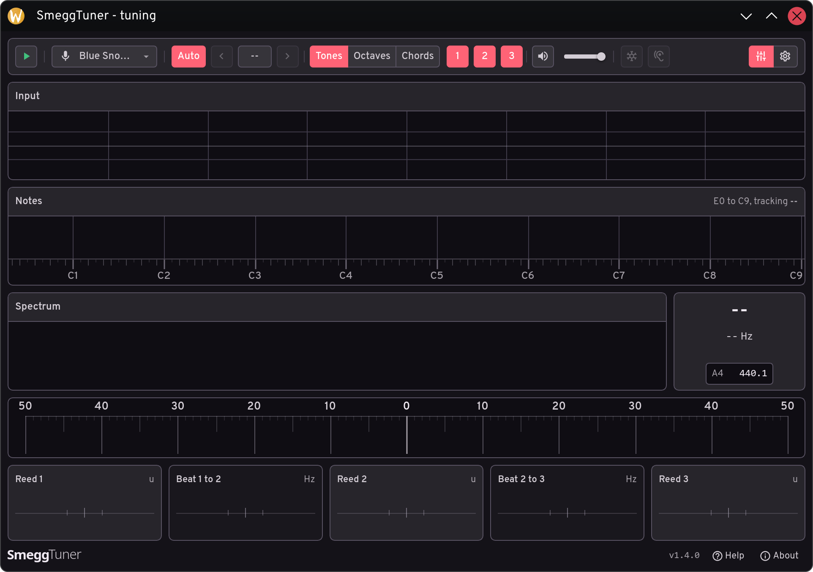
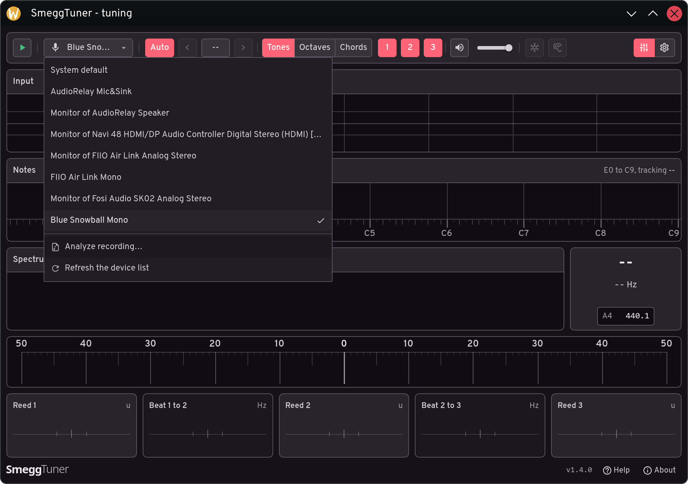
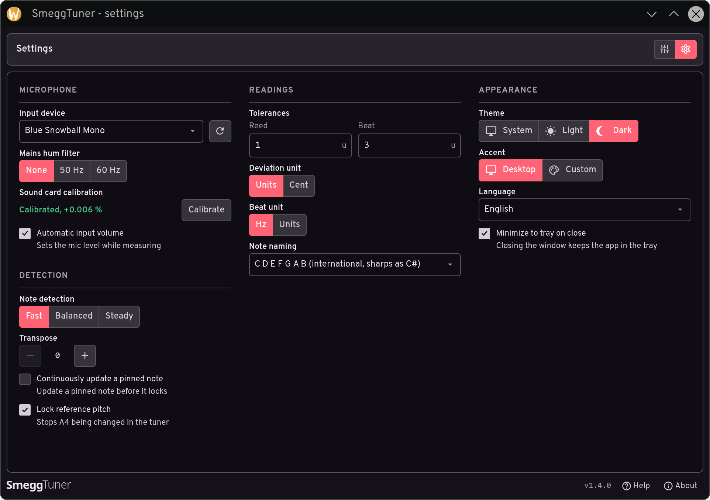
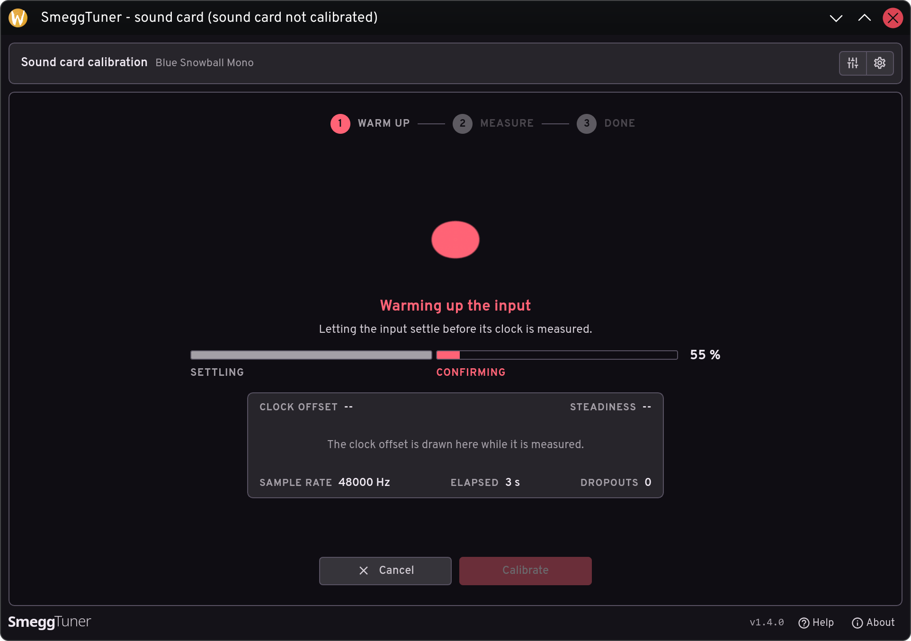
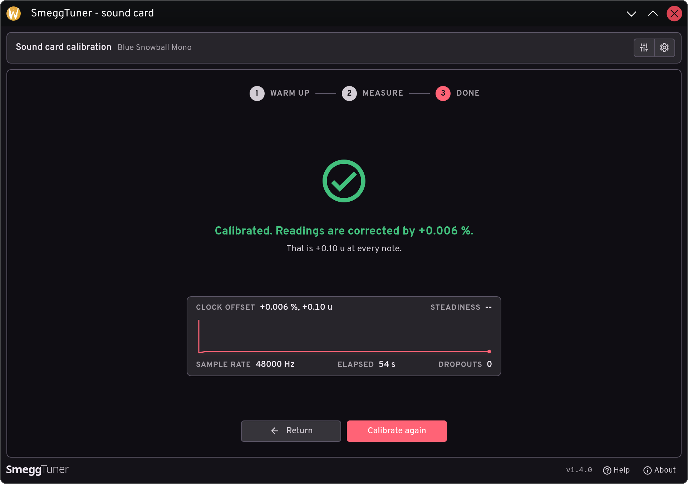

<p align="center">
  
</p>

<p align="center">
  English | <a href="README.pl.md">Polski</a> | <a href="https://smeggtuner.com">smeggtuner.com</a>
</p>

# SmeggTuner

An accordion tuner. It measures every reed of a note on its own, up to three at once, and the beat
between them, from a microphone or a WAV recording. It works the way Dirk's professional Accordion
Tuner does, and it is free.

Linux and Windows. Android and the browser edition are experimental.

It is a beta and has seen few accordions and sound cards so far. Check a reading against a tuner you
trust before you file a reed.

<p align="center">
  
</p>

## What it does

Tones reads the reeds of one note; Octaves and Chords read across notes. Deviation is in Dirk's units
(0.06 % of the note, about a cent) or in cents, and beats in Hz or units. Note detection is Fast,
Balanced or Steady; Steady picks and locks a note the way Dirk's tuner does.

Every microphone gets its own sound card calibration, which takes about a minute and needs no sound,
and its own background noise level, learned once and relearned from the top bar. The input volume can
follow the signal. The snowflake key holds each locked reading until the note stops.

A WAV file is measured the same way, with play, seek, loop and zoom. Clicking the note strip plays the
note. A4 goes from 430 to 450 Hz, with transpose, a 50 or 60 Hz mains filter and four note namings,
Polish (C Cis D ... H) among them.

If it cannot start, crashes, stops responding or gets killed, it opens a window with a report to copy,
save or email.

The Workshop from 1.3 (accordion library, sessions, recorded readings, goal curves and printed
reports) is switched off in 1.4. The code is still here and comes back in a later release.

## Dirk's tuner

| | Dirk's professional Accordion Tuner | SmeggTuner 1.4 |
|---|---|---|
| Price | 298 EUR, plus 148 EUR for recording and reports | Free |
| Source | Closed | MIT |
| Systems | Windows, macOS | Linux, Windows; Android and browser, experimental |
| Reeds at once | 3 | 3 |
| Tones, Octaves, Chords | Yes | Yes |
| Sound card calibration | Per device | Per microphone |
| Detection | One setting | Fast, Balanced, Steady |
| WAV files | Not in its menus | Yes |
| Recording and reports | Paid module | Not in 1.4 |

Prices from [dirksprojects.com](https://www.dirksprojects.com/), October 2026.

## Plans

- [ ] The Workshop back
- [ ] The browser edition at app.smeggtuner.com
- [ ] More accordions, microphones and sound cards tested
- [ ] macOS and iOS, once I have the hardware to test them

## Download

[Releases](https://github.com/smegg99/SmeggTuner/releases) or
[smeggtuner.com](https://smeggtuner.com):

- Linux x86_64: AppImage, DEB, RPM, Arch package
- Linux ARM64: DEB, RPM, Arch package
- Windows x86_64: installer, portable exe
- Android ARM64: APK, experimental

[CHANGELOG.md](CHANGELOG.md) lists what changed.

<table>
  <tr>
    <td></td>
    <td></td>
  </tr>
  <tr>
    <td></td>
    <td></td>
  </tr>
  <tr>
    <td></td>
    <td></td>
  </tr>
</table>

## Build

Linux only. Requires Go 1.27 with cgo, the GTK 3 and WebKit2GTK 4.1 headers
(`libgtk-3-dev libwebkit2gtk-4.1-dev` on Debian and Ubuntu, `gtk3-devel webkit2gtk4.1-devel` on
Fedora), Node.js `^22.22.3 || ^24.15.0 || >=26.0.0`, pnpm 11.3.0, [just](https://github.com/casey/just),
Python 3 and `rsvg-convert`. [S99AB](https://github.com/smegg99/S99AB),
[S99Wails](https://github.com/smegg99/S99Wails) and [S99Logger](https://github.com/smegg99/S99Logger)
checkouts go next to this one. Some of those libraries might not be published yet.

```sh
pnpm --dir ../S99AB install
just build
```

The binary is `bin/smeggtuner`. `just run` builds and opens it.

## Development

`just dev` rebuilds and restarts the debug build when a source changes. `just test` runs the Go,
frontend and build-script tests. `just check` also checks generated files, formatting, vet, locales,
types and lint without rewriting anything.

Locales live in `i18n/locales/{en,pl}` and the settings schema in
`backend/common/config/config.cue`; `just generate` rebuilds everything made from them, plus the
bindings, icons and S99Wails helpers.

`just web` builds the browser edition into `dist/web`. `just release` runs the checks and builds every
target into `dist/release/<version>`; the Android APK needs the signing keystore described in
[build/Android.md](build/Android.md).

`deploy.json` deploys the browser edition with [S99Deploy](https://github.com/smegg99/S99Deploy):
`deploy/app/fetch.sh` downloads the web archive of `VERSION` from its GitHub release and checks it against
the release's `SHA256SUMS`, and `deploy/app` is the small Go server that serves it. On the server,
`sudo depl up smeggtuner-app` deploys whatever version the checkout's `VERSION` names.

## Configuration

On first start it writes `config.json` with defaults, in the working directory, or in
`~/.config/smeggtuner` when installed from a package. The database and `logs/` sit beside it, or in
`~/.local/share/smeggtuner` when installed. A setting the schema does not know stops the start with a
window naming the file and the setting.

## License

MIT, see [LICENSE](LICENSE).
