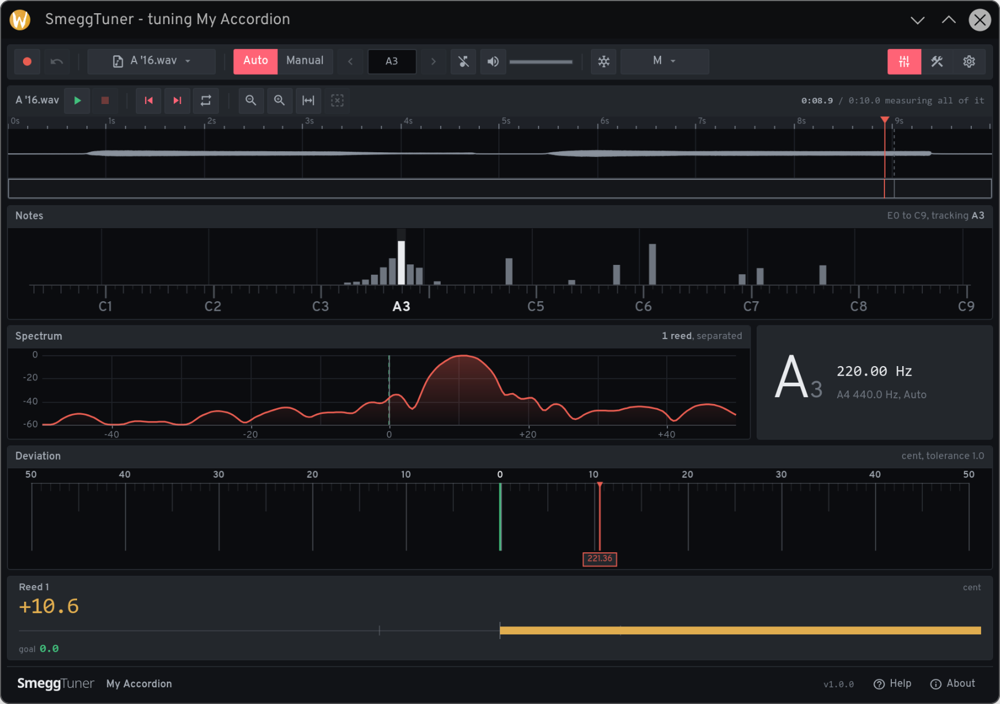
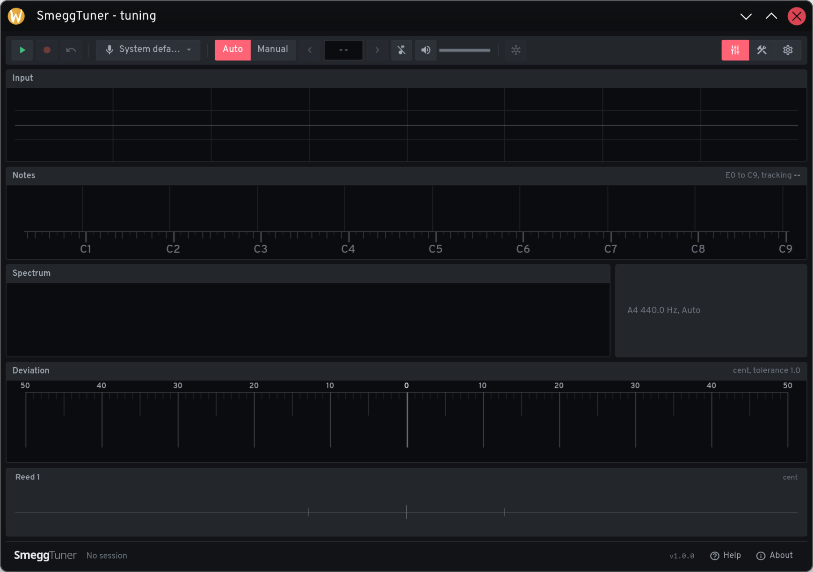
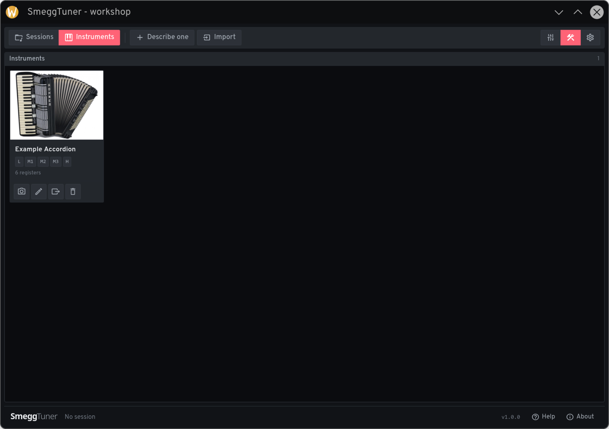
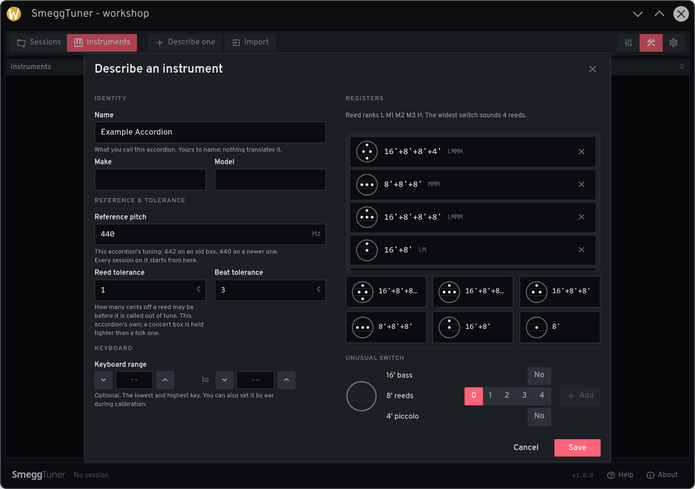
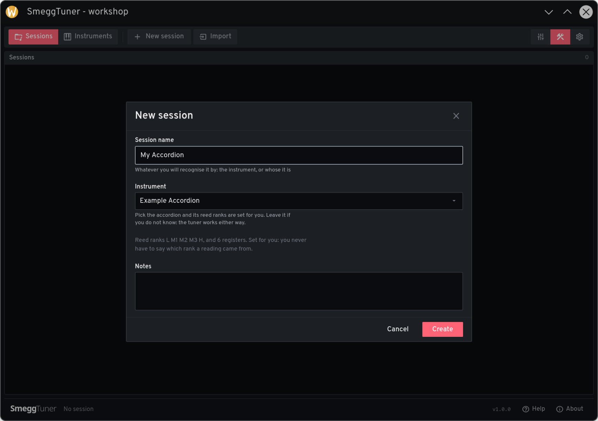
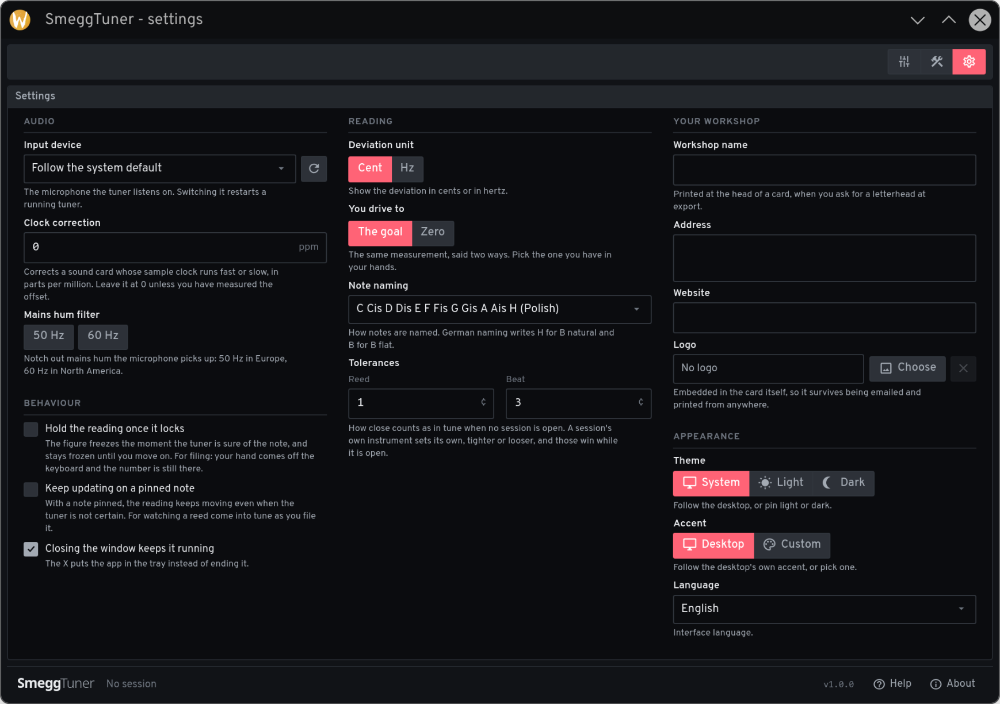

<p align="center">
  
</p>

<p align="center">
  <a href="https://smeggtuner.com">smeggtuner.com</a> · by Smegg99
</p>

SmeggTuner is a desktop tuner for accordions, a free reimplementation of Dirk's professional Accordion Tuner. It listens to a whole register at once, tells the reeds of a musette apart, and shows how far each one is from where it should be.

Built with Go, Wails 3, and Nuxt (Vue 3). [S99Wails](https://github.com/smegg99/S99Wails) supplies the native shell, theme, tray, window state, and desktop compatibility helpers. [S99AB](https://github.com/smegg99/S99AB) supplies the Nuxt layer, appearance, shared controls, panels, dialogs, and browser compatibility helpers. [S99Locale](https://github.com/smegg99/S99Locale) generates English and Polish messages for the UI, reports, tray, and logs from one canonical catalog.

## What It Does

- Measure reed frequencies, deviations and beats for the selected register. Display deviations in cents or reference units.
- Inspect individual reed slots and octave-spanning registers. Unresolved reeds remain missing rather than receiving an invented reading.
- The target is a goal curve you choose: none, anchors you type, or a curve fitted to readings you recorded.
- Sessions and the instrument library live in a local SQLite database; a session exports as a `.stsf` file and an instrument as a `.stif` (both plain zips).
- Reference recordings can be analysed from a WAV, so it works without an accordion on the desk.
- System tray integration; English and Polish.

A session contains one accordion and its measurement passes, with readings kept by note and register. Checking a note without opening a session creates nothing.

## Status

The measurement core follows independently reconstructed reference behavior. Automated checks cover synthetic signals and recorded samples; they do not establish full equivalence with Dirk's Accordion Tuner. Close or overlapping reeds can remain unresolved, and unlearned background tones can affect note selection. The recording tests document these limitations.

## Prerequisites

The desktop development commands below use Linux. Android has a separate build
and emulator workflow. Windows runtime behavior remains unverified.

- Go 1.27+ (with CGO enabled)
- Node.js matching `^22.22.3 || ^24.15.0 || >=26.0.0`; pnpm 11.3.0 (pinned in `frontend/package.json`)
- C compiler (gcc or clang), pkg-config
- Python 3 for build helpers and release-tooling checks
- GTK 3 dev headers (`libgtk-3-dev` on Debian/Ubuntu, `gtk3-devel` on Fedora)
- WebKit2GTK 4.1 dev headers (`libwebkit2gtk-4.1-dev`, `webkit2gtk4.1-devel`)
- Wails 3 CLI is a Go tool dependency, pinned to beta.34 with the runtime; recipes use `go tool wails3`
- Just; the Wails Taskfiles under `build/` only drive the platform packages
- librsvg (`rsvg-convert`) to render the app icon for the platform packages
- Sibling checkouts `../S99AB` and `../S99Wails`, required by the current local Go replacements and frontend link

## Setup

```sh
git clone https://github.com/smegg99/S99AB.git
git clone https://github.com/smegg99/S99Wails.git
git clone https://github.com/smegg99/SmeggTuner.git
cd SmeggTuner
pnpm --dir ../S99AB install
cd frontend && pnpm install && cd ..
just generate
just dev
```

`config.json` is generated from the CUE schema on first run.

Desktop and Android commands check the frontend Node requirements. If the shell
Node is incompatible, they use an existing fnm Node 22.22.3 installation for that
command only. They do not change the shell default or install Node.

For Android Studio, SDK/NDK setup, emulator profiles and APK/AAB builds, see
[Android development](build/Android.md). Android builds support ARM64 and x86_64,
with API 21 as the installation floor and WebView 95 as the browser floor.
Capture, session persistence, native import/export, Back navigation and PDF
printing have passed emulator checks. Physical microphone accuracy remains
unverified; see the Android guide for the tested OS/provider combinations.

## Development

```sh
just dev            # watch sources, rebuild and restart the debug app
just build          # production build -> bin/smeggtuner (just build debug for a debug one)
just run            # build and open the desktop app
just package        # per-user Linux archive and checksum -> dist/
just install        # build that archive and install it for you (menu entry, icon, ~/.local/bin)
just emulator       # start the default Android virtual device
just android        # build, install and launch on the selected ADB device
just android check  # run emulator checks on the existing debug APK
just adb devices    # list connected devices
just test           # build, then Go race, frontend and build-tooling tests
just check          # generated drift, build, gofmt, vet, version/locale drift, locale references, tests, types, lint
just bump 1.4.1     # set the version in VERSION and every stamped Wails, macOS and Windows file
just release        # just check, then every release target into dist/release/VERSION
```

The Go program lives under `backend/`: `main.go`, the wiring in `internal/app`, the engine and domain in `core/`, config, locale and logging adapters in `common/`, and the Wails services in `services/`. `just generate` (`scripts/generate.sh`) regenerates the config types, locales, the tray and window icons, the Wails bindings, the S99Wails frontend helpers, and the platform icons. Generated files are not edited by hand.

The artwork masters live in `assets/`. [`assets/trayicons.cue`](assets/trayicons.cue) renders `smeggtuner-cat.svg` into the tray icons and `smeggtuner-app-icon.svg` into the window icon, both under `backend/internal/trayicons`. The app icon SVG is also the menu icon on Linux and the source of the Windows, macOS and Android icons. `keycap.svg` and `keycap-light.svg` draw the key caps in the help dialog.

The archive from `just package` installs for one user without root: unpack it and run `./install.sh`. It writes `~/.local/lib/smeggtuner/`, `~/.local/bin/smeggtuner`, and the menu entry and icon; `~/.local/lib/smeggtuner/uninstall.sh` removes them and keeps the settings and sessions.

Edit translations in `i18n/locales/{en,pl}/*.yaml`, then run `just generate`.
The pinned `go tool loc` generates the native bundles/accessors in `backend/common/i18n`
and web bundles/plural rules in `frontend/i18n/generated`. Keep these outputs
with the source change. `just check` checks catalog contracts, generated
drift, source references, and report-template keys. Counts use CLDR categories;
Polish requires `one`, `few`, `many`, and `other`.

## Versioning

[`VERSION`](VERSION) is the single source of truth for the application version. Set it with
`just bump 1.4.1`, or edit it and run `just generate`. Build and package recipes synchronize the
generated Wails, macOS, Windows, NSIS, and MSIX metadata automatically. Use `just check` to verify them.

There is one config schema, `backend/common/config/config.cue`, and no migration between versions. A
`config.json` from an older version that no longer matches it stops the app at startup with the
validation error; delete it and the app writes fresh defaults.

## Releases

`just release` runs `just check`, then builds every target in `release_targets` into
`dist/release/VERSION` and writes `SHA256SUMS` for everything in it. Pass a subset with
`just release "linux/amd64 android/arm64"`. A target that fails, or reports success without its
artifacts, fails the release; the others still build.

| Target | Artifacts | Built by |
|---|---|---|
| `linux/amd64`, `linux/arm64` | `.AppImage`, `.deb`, `.rpm`, `.pkg.tar.zst`, per-user `.tar.zst` | Wails Linux tasks (`arm64` in the `wails-cross` Docker image), `scripts/package.sh` |
| `windows/amd64` | portable `.exe`, `-installer.exe` | the `win11` test-lab VM (`WINDOWS_LAB` picks another) |
| `android/arm64`, `android/amd64` | signed `.apk` and `.aab` | `build/android-support/android.sh package` and `bundle`; the keystore comes from its preflight |

## Screenshots

<div align="center">
  <table>
    <tr>
      <td align="center" style="padding-bottom: 20px;">
        <br>
        <em>Analysing a recording: the note, its spectrum, and each reed on the cent ruler.</em>
      </td>
      <td align="center" style="padding-bottom: 20px;">
        <br>
        <em>The tune view, live off the microphone, waiting for a note.</em>
      </td>
    </tr>
    <tr>
      <td align="center" style="padding-bottom: 20px;">
        <br>
        <em>The workshop and its instrument library.</em>
      </td>
      <td align="center" style="padding-bottom: 20px;">
        <br>
        <em>Describing an accordion, its registers built from the switch symbols.</em>
      </td>
    </tr>
    <tr>
      <td align="center">
        <br>
        <em>Starting a session on a described instrument.</em>
      </td>
      <td align="center">
        <br>
        <em>Settings: audio, reading, workshop letterhead, and appearance.</em>
      </td>
    </tr>
  </table>
</div>

## License

See [LICENSE](LICENSE).
