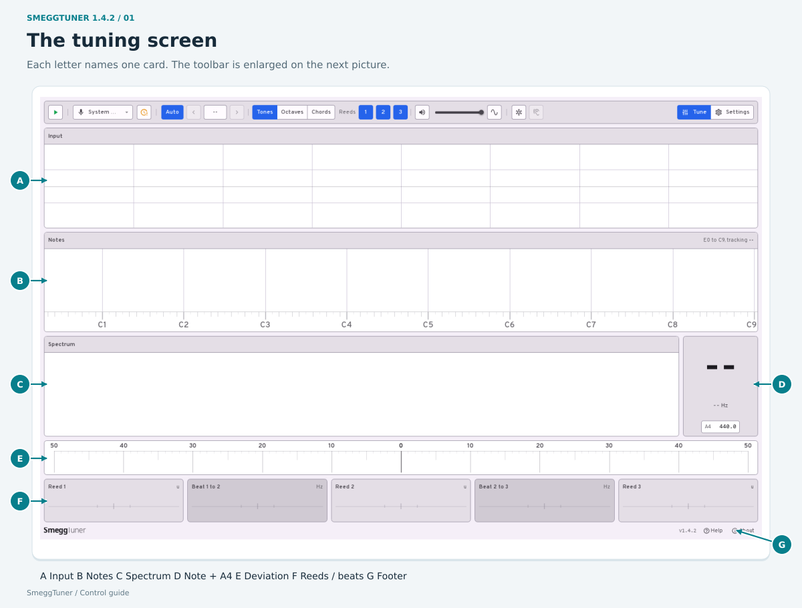
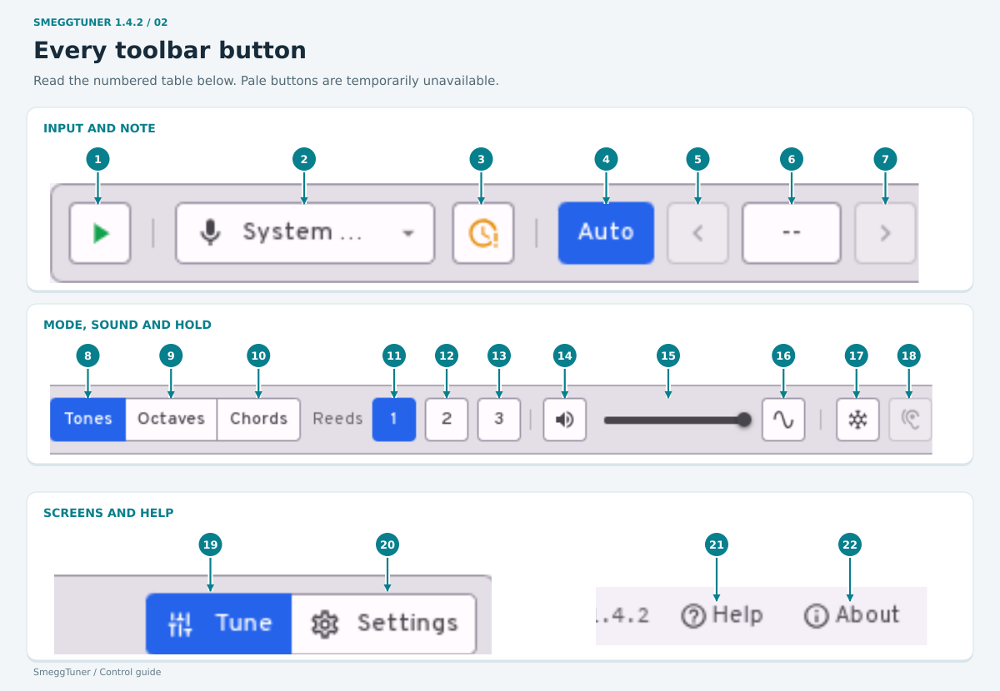
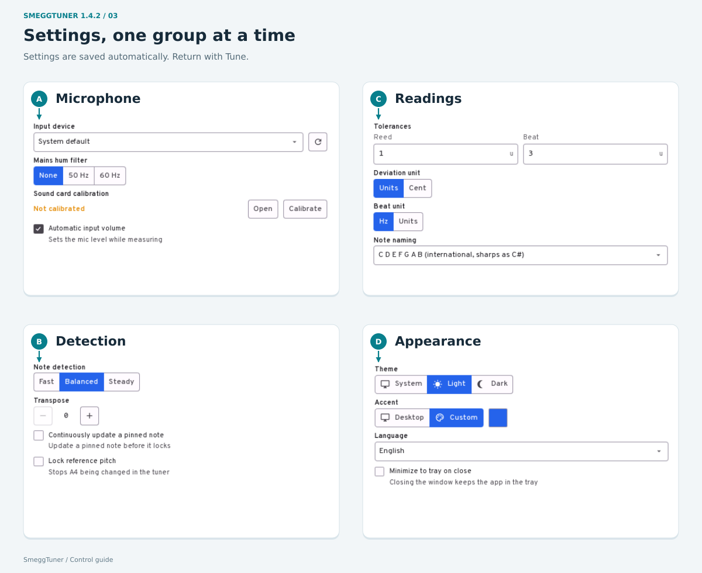
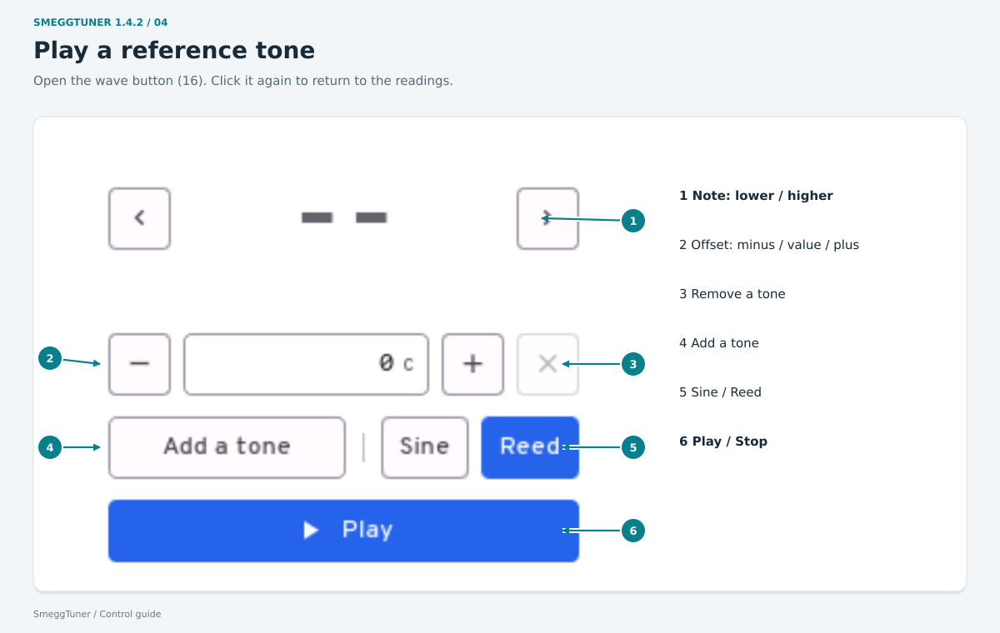
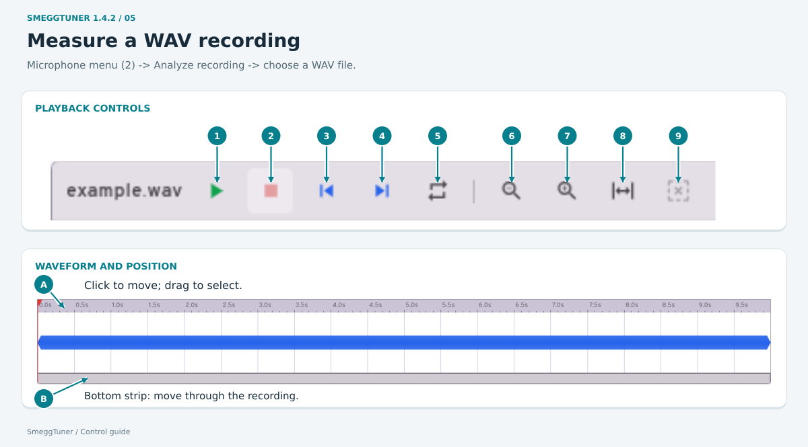
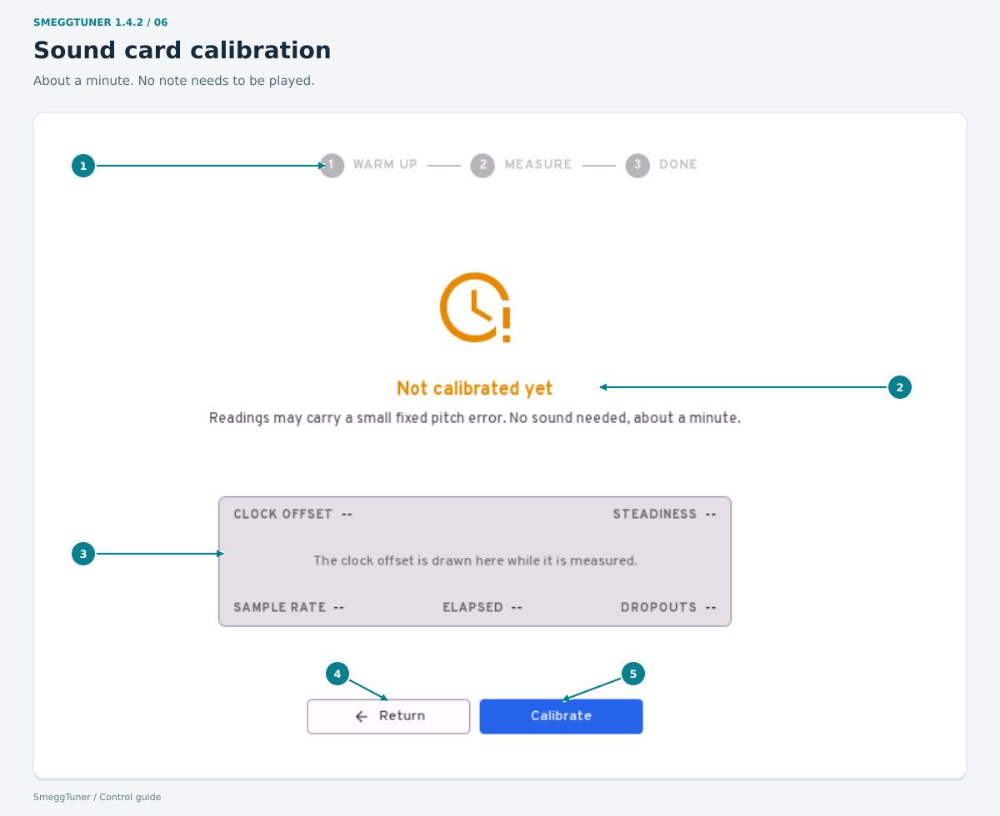

# SmeggTuner: how to use it

English | [Polski](USAGE.pl.md) - Desktop version 1.4.2

[First use](#first-use) | [Screen](#the-tuning-screen) | [Buttons](#every-toolbar-button) | [Settings](#settings) | [Reference sound](#signal-generator) | [WAV files](#wav-recordings) | [Calibration](#sound-card-calibration)

**Hover over a button and wait a moment to see what it does. No click needed. Click a picture to enlarge it.** A coloured button is selected; a pale button is unavailable in the current mode.

## First use

1. [Download and install](README.md#download) -> open **SmeggTuner** from your applications menu.
2. Plug in your microphone -> open the microphone menu -> choose it.
3. For a first try, choose a single-reed register on the accordion. Leave **Auto**, **Tones** and **Reeds 1** selected.
4. Click the green **Start** triangle. If asked: **Calibrate now** -> wait about a minute -> **Return** -> **Start** again.
5. Stay quiet for the first few seconds -> play one note steadily -> read the number under **Reed 1**. **Minus = too low. Plus = too high. Zero = on pitch.**
6. Click the **Stop** square when finished.

Tremolo reeds are deliberately offset. They need not all read zero.

## The tuning screen

This example has all three reeds on, so every result card is visible.

| Card | What it shows or does |
|---|---|
| **A - Input** | The sound reaching the microphone. Its header shows the input level while running. **Signal too strong** means the sound is overloading the input; move farther away or lower the input level. |
| **B - Notes** | The note range. Click a note to choose it manually. Holding the mouse down also plays that note unless output is muted; dragging moves between notes. **Auto** returns to automatic detection. In Chords mode, clicking plays a note but does not pin it. |
| **C - Spectrum** | The frequencies in the sound. Peaks help you see the reeds and their overtones. This is a display, not a button. |
| **D - Note and A4** | The note name, frequency in Hz, and status. **Lock** means a stable reading. Click the **A4** number, type the reference pitch and press **Enter**. The range is 430-450 Hz; **Esc** cancels the edit. Leave it at 440 unless you need another reference. |
| **E - Deviation scale** | Shows how far the sound is from the selected pitch: left is lower, right is higher, centre is zero. |
| **F - Reed 1 / Reed 2 / Reed 3** | Each card shows that reed's deviation. A blank or **not heard** result is not zero. Octaves and Chords change which sounds these cards represent. |
| **F - Beat 1 to 2** | The beat speed between the first and second reeds. |
| **F - Beat 2 to 3** | The beat speed between the second and third reeds. |
| **G - Bottom bar** | App name, version, messages, **Help**, and **About**. An error message here explains an action that failed. |

On a small window, **Input / Notes / Spectrum** become tabs. The tuning-controls button opens the extra toolbar controls. Left/right buttons beside the result cards show the other results when they do not all fit.

## Every toolbar button

| No. | Button or control | What to do |
|---|---|---|
| **1** | Start / Stop | Green triangle: listen to the microphone. Square: stop listening. For a WAV file, use its own Play button. |
| **2** | Microphone / file menu | Choose **System default**, a named microphone, or **Analyze recording** to open a WAV file. **Refresh the device list** looks for a newly connected microphone. Stop first to change the input. |
| **3** | Clock / calibration | Open sound card calibration. This reminder appears when calibration is missing, unreliable, or running. You can also open calibration from Settings. |
| **4** | Auto | Let the app choose the note you are playing. |
| **5** | Left arrow | With a note pinned, choose the next lower note. |
| **6** | Note name | Click to pin the current note. Click again, or use **Auto**, to release it. |
| **7** | Right arrow | With a note pinned, choose the next higher note. |
| **8** | Tones | Measure one note with up to three reeds sounding together. |
| **9** | Octaves | Measure a note together with its upper octaves. |
| **10** | Chords | Measure a three-note chord. Note pinning and reed-selection buttons are disabled here. |
| **11** | Reeds 1 | Include the first reed. In Octaves, this is the base note and stays on. |
| **12** | Reeds 2 | Include the second reed. In Octaves, include the note one octave higher. |
| **13** | Reeds 3 | Include the third reed. In Octaves, include the note two octaves higher. At least one reed must remain selected in Tones. |
| **14** | Speaker | Mute or unmute the app's sound: reference tones and WAV playback. This does not mute the microphone. |
| **15** | Volume slider | Change how loudly the app plays sound. Hover to see the percentage. Unmute first if the slider is disabled. |
| **16** | Wave symbol | Open or close the signal generator described below. |
| **17** | Snowflake | Hold each stable reading until the note ends. Click again to turn this off. |
| **18** | Ear | Learn the room's background noise again. Stay quiet for about four seconds. Available while the microphone is running and not already learning. |
| **19** | Tune | Return to the tuning screen. |
| **20** | Settings | Open the settings described below. |
| **21** | Help | Show the built-in instructions and keyboard shortcuts. Close with **X**. |
| **22** | About | Show the version, build information, and links to GitHub, LinkedIn, the website and donations. Links open in your browser. Close with **X**. |

## Settings

Changes save automatically. Click **Tune** to return.

| Group | Control | Meaning |
|---|---|---|
| **A - Microphone** | Input device + refresh arrow | Choose the microphone; refresh the list after plugging one in. Stop tuning before changing it. |
| A | Mains hum: None / 50 Hz / 60 Hz | Leave **None** unless you hear mains hum. Choose the appropriate frequency to filter it. Stop tuning before changing this. |
| A | Sound card calibration: Open | Show the calibration screen without starting a measurement. |
| A | Calibrate / Cancel | Start calibration, or cancel one that is running. The nearby text shows its status. |
| A | Automatic input volume | Let the app adjust the microphone level while measuring, if the device supports it. |
| **B - Detection** | Fast / Balanced / Steady | **Fast** follows changes quickly but may choose the wrong note. **Balanced** is a middle setting. **Steady** changes notes more slowly. |
| B | Transpose: minus / plus | Set how many semitones the instrument sounds above its note names, from 0 to 11. Used in Tones mode. Leave 0 for an untransposed instrument. |
| B | Continuously update a pinned note | Show updates before the manually chosen note has locked. |
| B | Lock reference pitch | Prevent changes to the A4 field on the tuning screen. |
| **C - Readings** | Tolerances: Reed / Beat | Type how much deviation you accept. Smaller numbers mean stricter judgement. These settings do not change the sound. |
| C | Deviation unit: Units / Cent | Choose how reed deviation is displayed. A unit is 0.06% of the note's frequency; a cent is one hundredth of a semitone. |
| C | Beat unit: Hz / Units | Show beat speed in hertz or in units relative to the note. |
| C | Note naming | Choose international **B**, German **H**, **Do Re Mi**, or Polish **C Cis D... H** names. |
| **D - Appearance** | Theme: System / Light / Dark | Follow the desktop theme, or choose a light or dark screen. |
| D | Accent: Desktop / Custom | Follow the desktop colour, or choose your own. Under **Custom**, click the colour square to open the picker. Choose a colour -> **Accept**. **Cancel** or **X** discards the choice. |
| D | Colour picker | Click a preset square, type a colour code in **#rrggbb**, or drag **Hue** (colour), **Saturation** (colour strength) and **Value** (brightness). The preview square shows your choice. **Accept** applies it; **Cancel / X** discards it. |
| D | Language | Switch between English and Polish. |
| D | Minimize to tray on close | Closing the window leaves the app running beside the desktop clock. Click its tray icon to hide/show it; the tray menu has **Show** and **Quit**. |

## Signal generator

Click toolbar button **16** to open it. It plays a reference sound for comparison by ear. Click **16** again to return to the readings.

| No. | Control | What it does |
|---|---|---|
| **1** | Left / right arrows and note | Choose a lower or higher note. The note and the frequencies below it show what will play. The header shows the A4 reference. |
| **2** | Minus / number / plus | Set each tone's offset in cents. Minus lowers it by one cent; plus raises it. You can also type the number and press Enter. Range: -100 to +100. **Esc** cancels typing. |
| **3** | X beside a tone | Remove that tone. The last tone cannot be removed. |
| **4** | Add a tone | Add another sound, up to four together. Each gets its own offset. |
| **5** | Sine / Reed | **Sine** is a plain tone. **Reed** includes overtones and sounds more like a reed. |
| **6** | Play / Stop | Start or stop the reference sound. With no note chosen, Play waits for the first detected note. While the tone sounds, microphone measurement pauses. |

The top **speaker and volume slider** control this sound too. The **Input** card remains above the generator.

## WAV recordings

Microphone menu **2** -> **Analyze recording** -> select a WAV file -> **Open**. **Cancel** leaves the current input unchanged. The file card replaces **Input**.

| No. | Control | What it does |
|---|---|---|
| **1** | Play / Pause | Play and measure the recording; pause at the current position. |
| **2** | Stop | Stop and return to the start of the selected part. |
| **3** | Skip to start | Jump to the start of the selected part. |
| **4** | Skip to end | Jump to its end. |
| **5** | Loop | Repeat the selected part, or the whole file if nothing is selected. |
| **6** | Magnifier minus | Zoom out to see more of the recording. |
| **7** | Magnifier plus | Zoom in to see a smaller part in detail. |
| **8** | Expand arrows | Show the whole recording. |
| **9** | Clear selection | Select the whole recording again. |
| **A** | Waveform and time line | Click to move the play position. Drag across the waveform to select a part. Drag the playhead or time line to move through the sound. Mouse wheel zooms; Shift + wheel moves the view sideways. |
| **B** | Bottom overview strip | Click or drag to move the visible window through the recording. |
| - | File name and time counter | The header shows the filename, current position and total duration. |

Use the top **speaker and volume slider** for playback sound. In a small window, the file's extra controls are under its tuning-controls button. To return to live tuning: stop playback -> microphone menu -> choose your microphone -> **Start**.

## Sound card calibration

Open the clock button **3**, or **Settings -> Sound card calibration -> Open**. It corrects the sound card's timing, separately for each microphone. No note needs to be played.

| No. | Area or control | What it means |
|---|---|---|
| **1** | Warm up -> Measure -> Done | The current stage. A progress indicator appears while measuring. |
| **2** | Status and result | Says whether calibration is missing, running, successful or unreliable. Follow the message if it asks you to retry. |
| **3** | Clock figures and graph | **Clock offset:** measured timing error. **Steadiness:** how much it varies. **Sample rate:** audio samples per second. **Elapsed:** time spent. **Dropouts:** missing audio blocks. These are readings, not settings. |
| **4** | Return / Cancel | Return to the previous screen; while measuring, this button cancels calibration. |
| **5** | Calibrate / Calibrate again | Start a measurement or repeat it. Wait until it finishes, usually about a minute. |

At first Start, **Calibrate now** opens and starts this process. **Continue uncorrected** starts tuning without that correction. After calibration, return to Tune and press Start.

## Keyboard and small windows

| Where | Keys | Action |
|---|---|---|
| Main screens | **1 / 2** | Tune / Settings. These keys do not select reed counts. |
| Tuner | **A** | Switch automatic/manual note selection. |
| Pinned note | **Left / Right**, or **comma / full stop** | Previous/next note. |
| Tuner | **H**; **Space** with microphone input | Toggle hold. |
| Signal generator | **Space**; **Left / Right**; **Down / Up** | Play/stop; change one semitone; change one octave. |
| WAV file | **Space**, **Home / End**, **L**, **M** | Play/pause, selected start/end, loop, mute. |
| WAV file | **+ / -**, **F**, **S** | Zoom in/out, fit whole file, fit selected part. |

Shortcuts do not take over while you are typing in a field or using an open dialog. In a small window, use the **Input / Notes / Spectrum** tabs, the toolbar's extra-controls menu and the arrows beside result cards.

## If nothing appears

**Stop -> check the microphone -> Start.** Stay quiet while the app learns the room noise, then hold one note steadily. **Too quiet** means it cannot hear enough sound. **Signal unreliable** means the input is not dependable. A grey control often becomes available after stopping, changing mode, or selecting a note; hover over it for the reason.

If an error-report window opens, the message and details describe the failure. Its available buttons are:

| Button | Action |
|---|---|
| Copy report / Save report | Copy the report or save it to a file. |
| Email report / Show log file | Open your email application with the report, or open the log file. |
| Wait / Close and report | Give an unresponsive app more time, or close it and prepare its report. |
| Close / Restart | Dismiss the report window or try starting the app again. |
