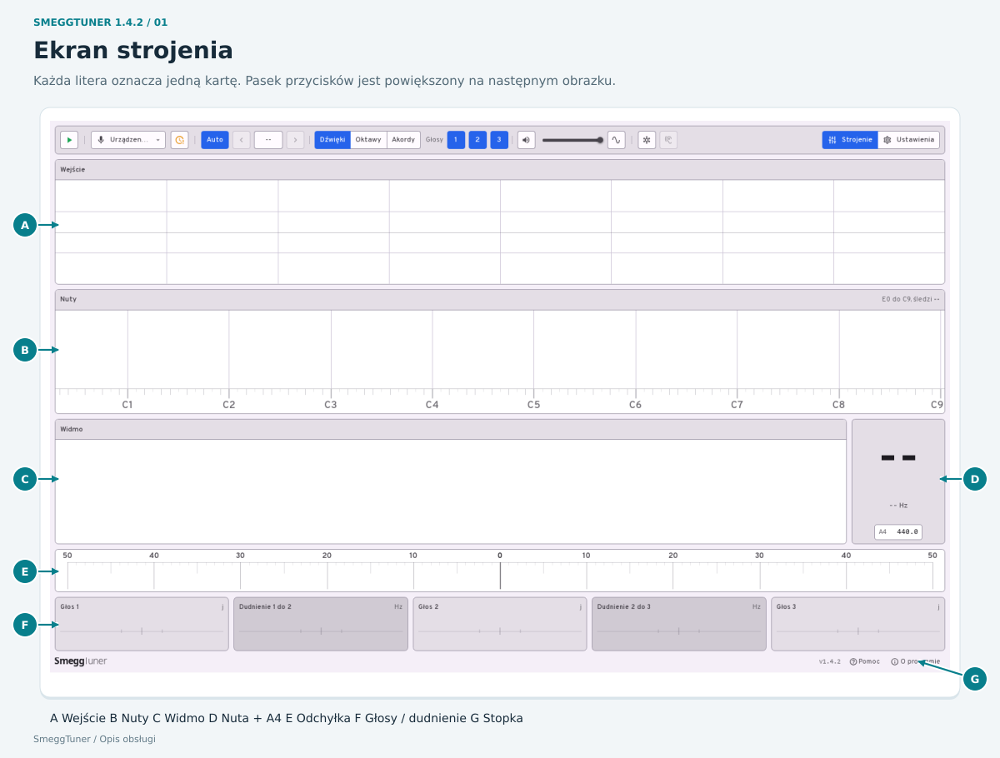
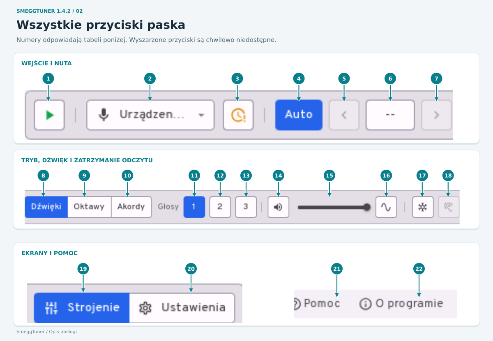
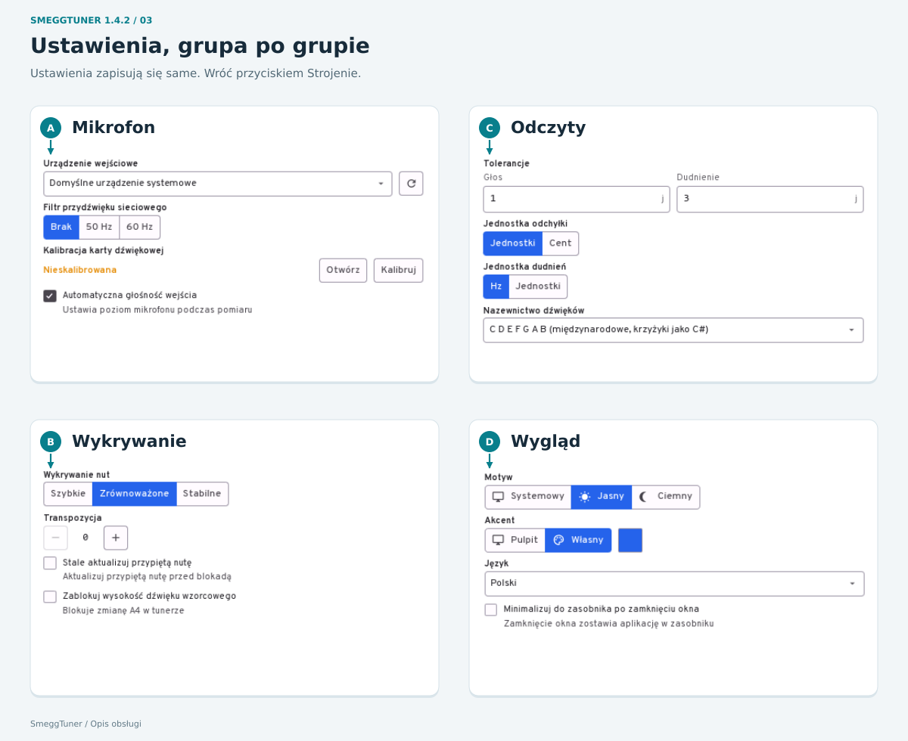
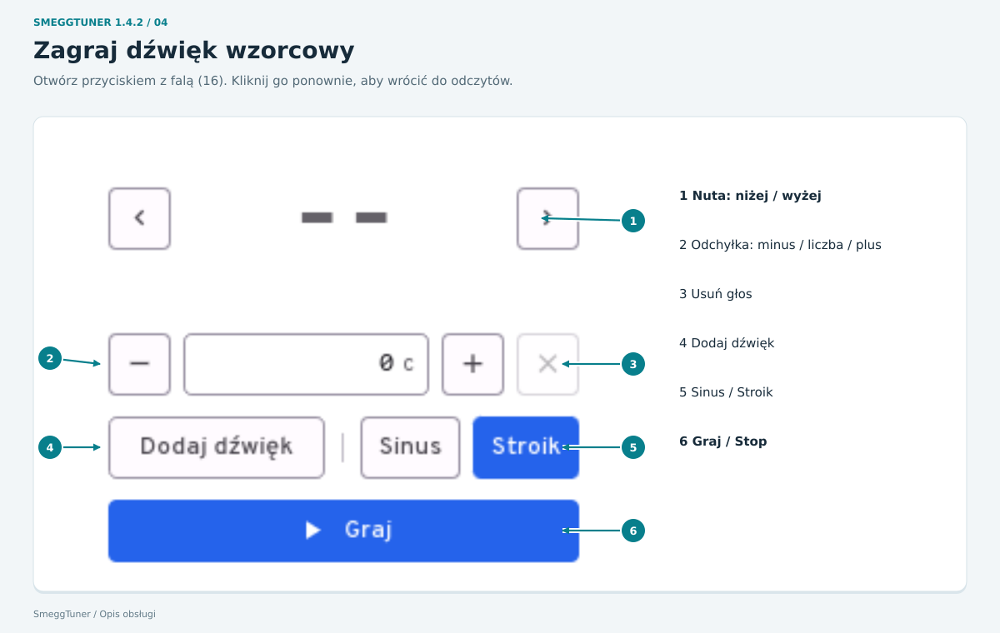
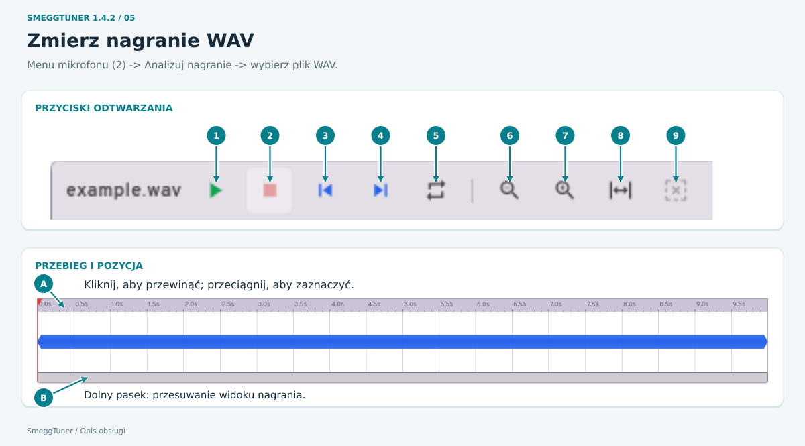
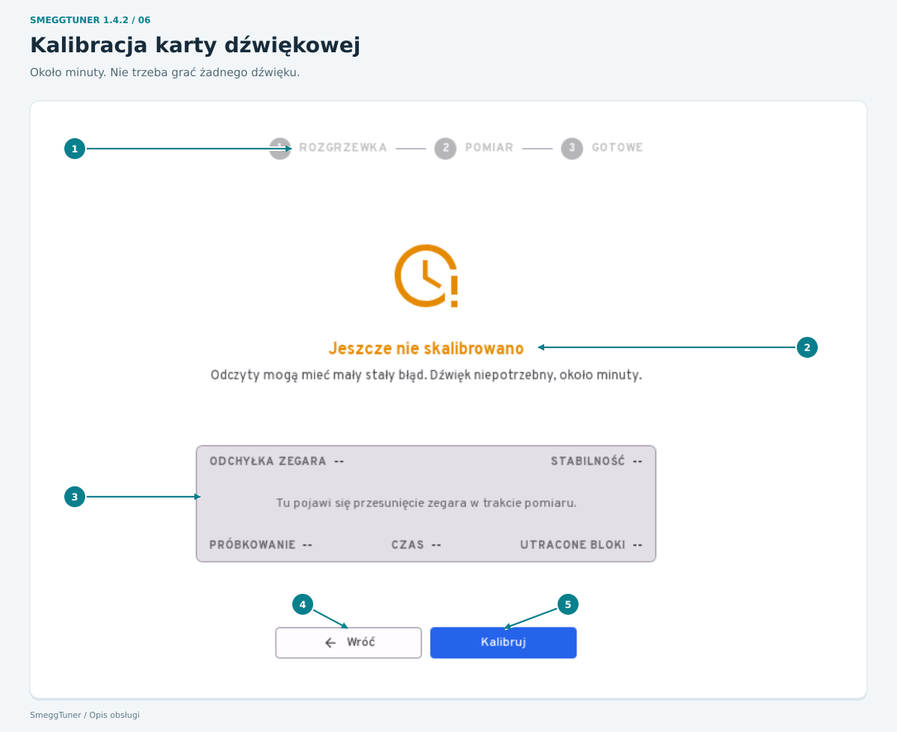

# SmeggTuner: jak używać

[English](USAGE.md) | Polski - SmeggTuner 1.4

[Pierwsze użycie](#pierwsze-użycie) | [Ekran](#ekran-strojenia) | [Przyciski](#wszystkie-przyciski-paska) | [Ustawienia](#ustawienia) | [Dźwięk wzorcowy](#generator-sygnału) | [Pliki WAV](#nagrania-wav) | [Kalibracja](#kalibracja-karty-dźwiękowej)

**Najedź myszką na przycisk i chwilę poczekaj. Podpowiedź wyjaśni, do czego służy. Nie trzeba klikać. Kliknij obrazek, aby go powiększyć.** Kolorowy przycisk jest wybrany; wyszarzony jest niedostępny w obecnym trybie.

Ta instrukcja i ilustracje są dostępne bez internetu przez **Pomoc** lub **O programie -> Jak używać SmeggTunera**. **O programie -> Polityka prywatności** opisuje sposób przetwarzania danych, również bez połączenia z internetem.

Na Androidzie zezwól na użycie mikrofonu, gdy aplikacja o to poprosi. Po odmowie nadal możesz analizować plik WAV. Przechwytywanie dźwięku zatrzymuje się po opuszczeniu aplikacji. Na Androidzie i w wersji przeglądarkowej cały panel dopasowuje się do ekranu. Obróć telefon, aby uzyskać większy widok. Ustawienia dotyczące tylko komputera, na przykład zasobnika systemowego, nie dotyczą Androida.

## Pierwsze użycie

1. [Pobierz i zainstaluj](README.md#download) -> otwórz **SmeggTuner** z menu aplikacji.
2. Podłącz mikrofon -> otwórz menu z mikrofonem -> wybierz go.
3. Na początek wybierz w akordeonie rejestr z jednym głosem. Zostaw włączone **Auto**, **Dźwięki** i **Głosy 1**.
4. Kliknij zielony trójkąt **Start**. Jeśli pojawi się pytanie: **Kalibruj teraz** -> poczekaj około minuty -> **Wróć** -> ponownie **Start**.
5. Przez pierwsze kilka sekund zachowaj ciszę -> zagraj jedną nutę równym dźwiękiem -> odczytaj liczbę pod **Głos 1**. **Minus = za nisko. Plus = za wysoko. Zero = właściwa wysokość.**
6. Na koniec kliknij kwadrat **Stop**.

Stroiki tremolo są celowo odstrojone. Nie wszystkie mają wskazywać zero.

## Ekran strojenia

W tym przykładzie włączono trzy głosy, żeby pokazać wszystkie karty wyników.

| Karta | Co pokazuje lub robi |
|---|---|
| **A - Wejście** | Dźwięk docierający do mikrofonu. Podczas pracy nagłówek pokazuje poziom wejścia. **Sygnał za silny** oznacza przeciążenie wejścia; odsuń mikrofon lub zmniejsz poziom wejściowy. |
| **B - Nuty** | Zakres nut. Kliknij nutę, aby wybrać ją ręcznie. Przytrzymanie myszy również ją odtwarza, chyba że dźwięk aplikacji jest wyciszony. Przeciąganie przechodzi między nutami. **Auto** przywraca automatyczny wybór. W trybie Akordy kliknięcie odtwarza nutę, ale jej nie przypina. |
| **C - Widmo** | Częstotliwości w dźwięku. Szczyty pomagają zobaczyć głosy i ich alikwoty. To wykres, nie przycisk. |
| **D - Nuta i A4** | Nazwa nuty, częstotliwość w Hz i stan odczytu. Blokada oznacza ustabilizowany odczyt. Kliknij liczbę **A4**, wpisz częstotliwość wzorcową i naciśnij **Enter**. Zakres: 430-450 Hz. **Esc** anuluje zmianę. Zostaw 440, jeśli nie potrzebujesz innego wzorca. |
| **E - Skala odchyłki** | Pokazuje różnicę względem wybranej wysokości: w lewo jest niżej, w prawo wyżej, pośrodku jest zero. |
| **F - Głos 1 / Głos 2 / Głos 3** | Każda karta pokazuje odchyłkę jednego stroika. Puste pole lub **nie słychać** nie oznacza zera. Tryby Oktawy i Akordy zmieniają to, jakie dźwięki przedstawiają karty. |
| **F - Dudnienie 1 do 2** | Szybkość dudnienia między pierwszym a drugim głosem. |
| **F - Dudnienie 2 do 3** | Szybkość dudnienia między drugim a trzecim głosem. |
| **G - Dolny pasek** | Nazwa aplikacji, wersja, komunikaty, **Pomoc** i **O programie**. Komunikat błędu wyjaśnia, dlaczego czynność się nie udała. |

W małym oknie **Wejście / Nuty / Widmo** stają się zakładkami. Przycisk sterowania strojeniem otwiera dodatkowe przyciski paska. Strzałki przy kartach wyników pokazują pozostałe wyniki, gdy wszystkie nie mieszczą się naraz.

## Wszystkie przyciski paska

| Nr | Przycisk lub suwak | Do czego służy |
|---|---|---|
| **1** | Start / Stop | Zielony trójkąt: słuchaj mikrofonu. Kwadrat: zatrzymaj słuchanie. Plik WAV ma własny przycisk odtwarzania. |
| **2** | Menu mikrofonu / pliku | Wybierz urządzenie domyślne, konkretny mikrofon albo **Analizuj nagranie**, aby otworzyć WAV. Odświeżenie listy wyszukuje nowo podłączony mikrofon. Najpierw zatrzymaj strojenie. |
| **3** | Zegar / kalibracja | Otwórz kalibrację karty dźwiękowej. Przypomnienie pojawia się, gdy kalibracji brakuje, jest niewiarygodna lub trwa. Kalibrację można też otworzyć w Ustawieniach. |
| **4** | Auto | Aplikacja sama wybiera graną nutę. |
| **5** | Strzałka w lewo | Przy przypiętej nucie wybierz następną niższą nutę. |
| **6** | Nazwa nuty | Kliknij, aby przypiąć obecną nutę. Kliknij ponownie lub wybierz **Auto**, aby ją zwolnić. |
| **7** | Strzałka w prawo | Przy przypiętej nucie wybierz następną wyższą nutę. |
| **8** | Dźwięki | Mierz jedną nutę, z maksymalnie trzema stroikami brzmiącymi razem. |
| **9** | Oktawy | Mierz nutę razem z jej wyższymi oktawami. |
| **10** | Akordy | Mierz akord z trzech nut. Ręczny wybór nuty i przyciski głosów są tu wyłączone. |
| **11** | Głosy 1 | Uwzględnij pierwszy głos. W Oktawach to nuta podstawowa, zawsze włączona. |
| **12** | Głosy 2 | Uwzględnij drugi głos. W Oktawach: dźwięk o oktawę wyższy. |
| **13** | Głosy 3 | Uwzględnij trzeci głos. W Oktawach: dźwięk o dwie oktawy wyższy. W trybie Dźwięki co najmniej jeden głos musi pozostać włączony. |
| **14** | Głośnik | Wycisz lub włącz dźwięk aplikacji: dźwięki wzorcowe i odtwarzanie WAV. Nie wycisza mikrofonu. |
| **15** | Suwak głośności | Ustaw głośność dźwięku odtwarzanego przez aplikację. Najedź myszką, aby zobaczyć procent. Jeśli suwak jest wyłączony, najpierw włącz głośnik. |
| **16** | Symbol fali | Otwórz lub zamknij generator sygnału opisany niżej. |
| **17** | Śnieżynka | Zatrzymaj każdy stabilny odczyt, aż nuta ucichnie. Kliknij ponownie, aby wyłączyć. |
| **18** | Ucho | Naucz aplikację szumu pomieszczenia od nowa. Zachowaj ciszę przez około cztery sekundy. Działa, gdy mikrofon pracuje i aplikacja nie uczy się już szumu. |
| **19** | Strojenie | Wróć do ekranu strojenia. |
| **20** | Ustawienia | Otwórz ustawienia opisane niżej. |
| **21** | Pomoc | Pokaż instrukcję w aplikacji i skróty klawiaturowe. Zamknij przyciskiem **X**. |
| **22** | O programie | Pokaż wersję oraz dostępną bez internetu instrukcję obsługi, politykę prywatności i licencję. Odnośniki do strony, GitHuba i wsparcia otwierają się poza aplikacją. Zamknij przyciskiem **X**. |

## Ustawienia

Zmiany zapisują się same. Wróć przyciskiem **Strojenie**.

| Grupa | Ustawienie | Znaczenie |
|---|---|---|
| **A - Mikrofon** | Urządzenie wejściowe i strzałka odświeżania | Wybierz mikrofon; po podłączeniu nowego odśwież listę. Najpierw zatrzymaj strojenie. |
| A | Filtr przydźwięku: Brak / 50 Hz / 60 Hz | Zostaw **Brak**, chyba że słychać przydźwięk sieciowy. Wybierz jego częstotliwość, aby go filtrować. Najpierw zatrzymaj strojenie. |
| A | Kalibracja karty: Otwórz | Pokaż ekran kalibracji bez rozpoczynania pomiaru. |
| A | Kalibruj / Anuluj | Rozpocznij kalibrację lub anuluj trwającą. Obok widać jej stan. |
| A | Automatyczna głośność wejścia | Pozwól aplikacji regulować poziom mikrofonu podczas pomiaru, jeśli urządzenie to obsługuje. |
| **B - Wykrywanie** | Szybkie / Zrównoważone / Stabilne | **Szybkie** szybko śledzi zmiany, ale może pomylić nutę. **Zrównoważone** jest ustawieniem pośrednim. **Stabilne** wolniej zmienia nuty. |
| B | Transpozycja: minus / plus | Ustaw, o ile półtonów instrument brzmi wyżej od nazw nut, od 0 do 11. Działa w trybie Dźwięki. Bez transpozycji zostaw 0. |
| B | Stale aktualizuj przypiętą nutę | Pokazuj zmiany ręcznie wybranej nuty, zanim odczyt się ustabilizuje. |
| B | Zablokuj wysokość dźwięku wzorcowego | Zablokuj zmianę pola A4 na ekranie strojenia. |
| **C - Odczyty** | Tolerancje: Głos / Dudnienie | Wpisz dopuszczalną odchyłkę. Mniejsze liczby oznaczają surowszą ocenę. Te ustawienia nie zmieniają dźwięku. |
| C | Jednostka odchyłki: Jednostki / Cent | Wybierz sposób wyświetlania odchyłki stroika. Jednostka to 0,06% częstotliwości nuty; cent to jedna setna półtonu. |
| C | Jednostka dudnień: Hz / Jednostki | Pokazuj szybkość dudnienia w hercach albo w jednostkach zależnych od nuty. |
| C | Nazewnictwo dźwięków | Wybierz międzynarodowe **B**, niemieckie **H**, **Do Re Mi** albo polskie **C Cis D... H**. |
| **D - Wygląd** | Motyw: Systemowy / Jasny / Ciemny | Użyj motywu pulpitu albo wybierz jasny lub ciemny ekran. |
| D | Akcent: Pulpit / Własny | Użyj koloru pulpitu albo własnego. Przy **Własny** kliknij kolorowy kwadrat. Wybierz kolor -> **Zatwierdź**. **Anuluj** lub **X** odrzuca wybór. |
| D | Wybór koloru | Kliknij gotowy kolor, wpisz kod w polu **#rrggbb** albo przeciągnij suwaki **Barwa**, **Nasycenie** i **Jasność**. Kwadrat podglądu pokazuje wybór. **Zatwierdź** go stosuje; **Anuluj / X** odrzuca. |
| D | Język | Przełącz między polskim a angielskim. |
| D | Minimalizuj do zasobnika po zamknięciu okna | Po zamknięciu okna aplikacja pozostaje obok zegara pulpitu. Kliknięcie jej ikony ukrywa/pokazuje okno; menu ikony zawiera **Pokaż** i **Zakończ**. |

## Generator sygnału

Otwórz przyciskiem **16**. Odtwarza dźwięk wzorcowy do porównania na słuch. Kliknij **16** ponownie, aby wrócić do odczytów.

| Nr | Element | Do czego służy |
|---|---|---|
| **1** | Strzałki w lewo / w prawo i nuta | Wybierz niższą lub wyższą nutę. Nazwa i częstotliwości poniżej pokazują, co zostanie zagrane. Nagłówek podaje wzorzec A4. |
| **2** | Minus / liczba / plus | Ustaw odstrojenie każdego głosu w centach. Minus obniża o jeden cent; plus podwyższa. Możesz też wpisać liczbę i nacisnąć Enter. Zakres: od -100 do +100. **Esc** anuluje wpisywanie. |
| **3** | X przy głosie | Usuń ten głos. Ostatniego nie można usunąć. |
| **4** | Dodaj dźwięk | Dodaj kolejny dźwięk, maksymalnie cztery naraz. Każdy ma własne odstrojenie. |
| **5** | Sinus / Stroik | **Sinus** to prosty ton. **Stroik** zawiera alikwoty i bardziej przypomina dźwięk stroika. |
| **6** | Graj / Stop | Rozpocznij lub zatrzymaj dźwięk wzorcowy. Bez wybranej nuty odtwarzanie czeka na pierwszą wykrytą nutę. Podczas grania wzorca pomiar z mikrofonu jest wstrzymany. |

Górny **głośnik i suwak głośności** regulują również ten dźwięk. Karta **Wejście** pozostaje nad generatorem.

## Nagrania WAV

Menu mikrofonu **2** -> **Analizuj nagranie** -> wybierz plik WAV -> **Otwórz**. **Anuluj** pozostawia obecne wejście. Karta pliku zastępuje **Wejście**.

| Nr | Element | Do czego służy |
|---|---|---|
| **1** | Odtwarzanie / Pauza | Odtwarzaj i mierz nagranie; zatrzymaj chwilowo w obecnym miejscu. |
| **2** | Stop | Zatrzymaj i wróć na początek zaznaczonego fragmentu. |
| **3** | Skok na początek | Przejdź na początek zaznaczonego fragmentu. |
| **4** | Skok na koniec | Przejdź na jego koniec. |
| **5** | Pętla | Powtarzaj zaznaczony fragment, a bez zaznaczenia całe nagranie. |
| **6** | Lupa z minusem | Oddal widok, aby zobaczyć więcej nagrania. |
| **7** | Lupa z plusem | Przybliż widok, aby dokładniej zobaczyć krótszy fragment. |
| **8** | Rozsuwające się strzałki | Pokaż całe nagranie. |
| **9** | Usuń zaznaczenie | Ponownie wybierz całe nagranie. |
| **A** | Przebieg i oś czasu | Kliknij, aby przesunąć pozycję odtwarzania. Przeciągnij po przebiegu, aby zaznaczyć fragment. Przeciągnij wskaźnik lub oś czasu, aby przewijać. Kółko myszy zmienia powiększenie; Shift + kółko przesuwa widok. |
| **B** | Dolny pasek podglądu | Kliknij lub przeciągnij, aby przesunąć widoczny fragment nagrania. |
| - | Nazwa pliku i licznik czasu | Nagłówek pokazuje nazwę pliku, obecną pozycję i całkowity czas. |

Górny **głośnik i suwak głośności** regulują dźwięk odtwarzania. W małym oknie dodatkowe przyciski pliku są w jego menu sterowania. Powrót do mikrofonu: zatrzymaj odtwarzanie -> menu mikrofonu -> wybierz mikrofon -> **Start**.

## Kalibracja karty dźwiękowej

Otwórz przyciskiem zegara **3** lub przez **Ustawienia -> Kalibracja karty dźwiękowej -> Otwórz**. Koryguje pomiar czasu karty dźwiękowej, osobno dla każdego mikrofonu. Nie trzeba grać żadnej nuty.

| Nr | Element | Znaczenie |
|---|---|---|
| **1** | Rozgrzewka -> Pomiar -> Gotowe | Obecny etap. Podczas pomiaru pojawia się wskaźnik postępu. |
| **2** | Stan i wynik | Informuje, czy kalibracji brakuje, trwa, udała się lub jest niewiarygodna. Jeśli komunikat prosi o ponowienie, spróbuj jeszcze raz. |
| **3** | Dane zegara i wykres | **Odchyłka zegara:** zmierzony błąd czasu. **Stabilność:** jak bardzo się zmienia. **Próbkowanie:** liczba próbek dźwięku na sekundę. **Czas:** ile trwa pomiar. **Utracone bloki:** brakujące bloki dźwięku. To odczyty, nie ustawienia. |
| **4** | Wróć / Anuluj | Wróć do poprzedniego ekranu; podczas pomiaru ten przycisk anuluje kalibrację. |
| **5** | Kalibruj / Kalibruj ponownie | Rozpocznij pomiar lub go powtórz. Zaczekaj na zakończenie, zwykle około minuty. |

Przy pierwszym Start przycisk **Kalibruj teraz** otwiera i rozpoczyna ten proces. **Kontynuuj bez korekcji** rozpoczyna strojenie bez tej poprawki. Po kalibracji wróć do Strojenia i naciśnij Start.

## Klawiatura i małe okna

| Gdzie | Klawisze | Działanie |
|---|---|---|
| Główne ekrany | **1 / 2** | Strojenie / Ustawienia. Te klawisze nie wybierają liczby głosów. |
| Tuner | **A** | Przełącz automatyczny/ręczny wybór nuty. |
| Przypięta nuta | **Lewo / Prawo** albo **przecinek / kropka** | Poprzednia/następna nuta. |
| Tuner | **H**; **Spacja** przy mikrofonie | Włącz/wyłącz zatrzymywanie odczytu. |
| Generator | **Spacja**; **Lewo / Prawo**; **Dół / Góra** | Graj/stop; zmień o półton; zmień o oktawę. |
| Plik WAV | **Spacja**, **Home / End**, **L**, **M** | Odtwarzaj/pauza, początek/koniec zaznaczenia, pętla, wyciszenie. |
| Plik WAV | **+ / -**, **F**, **S** | Przybliż/oddal, pokaż cały plik, pokaż zaznaczony fragment. |

Skróty nie przejmują klawiszy podczas wpisywania w polu lub korzystania z otwartego okna dialogowego. W małym oknie używaj zakładek **Wejście / Nuty / Widmo**, menu dodatkowych przycisków oraz strzałek przy kartach wyników.

## Jeśli nic się nie pojawia

**Stop -> sprawdź mikrofon -> Start.** Zachowaj ciszę podczas uczenia szumu pomieszczenia, potem trzymaj jedną nutę równym dźwiękiem. **Za cicho** oznacza, że aplikacja słyszy za mało dźwięku. **Sygnał niepewny** oznacza problem z jakością wejścia. Wyszarzony przycisk często staje się dostępny po zatrzymaniu, zmianie trybu lub wybraniu nuty; najedź na niego myszką, aby poznać powód.

Jeśli otworzy się okno raportu błędu, komunikat i szczegóły opisują awarię. Dostępne przyciski to:

| Przycisk | Działanie |
|---|---|
| Kopiuj raport / Zapisz raport | Skopiuj raport lub zapisz go do pliku. |
| Wyślij raport e-mailem / Pokaż plik dziennika | Otwórz program pocztowy z raportem albo plik dziennika. |
| Zaczekaj / Zamknij i zgłoś | Daj zawieszonej aplikacji więcej czasu albo zamknij ją i przygotuj raport. |
| Zamknij / Uruchom ponownie | Zamknij okno raportu albo spróbuj ponownie uruchomić aplikację. |
